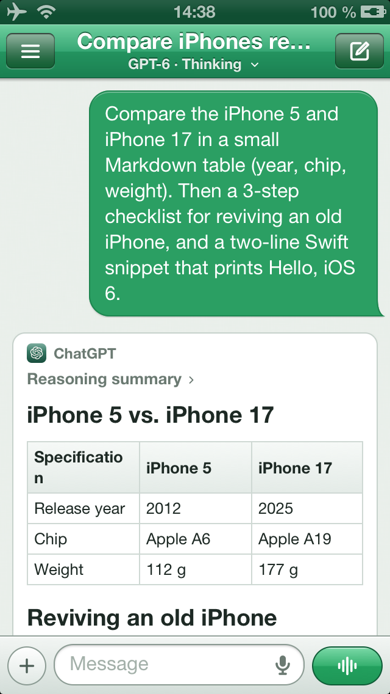
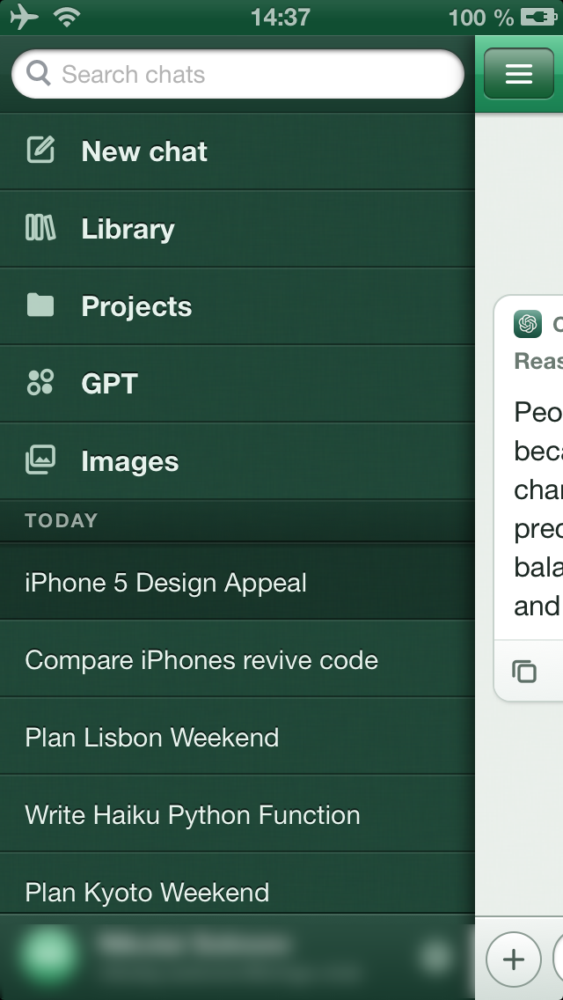
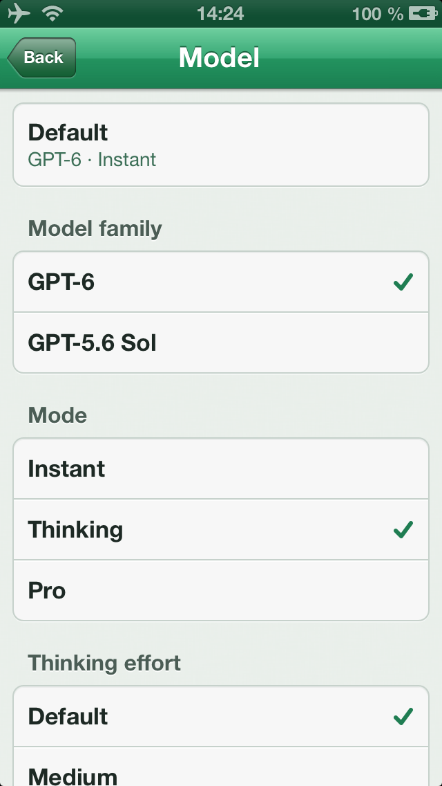
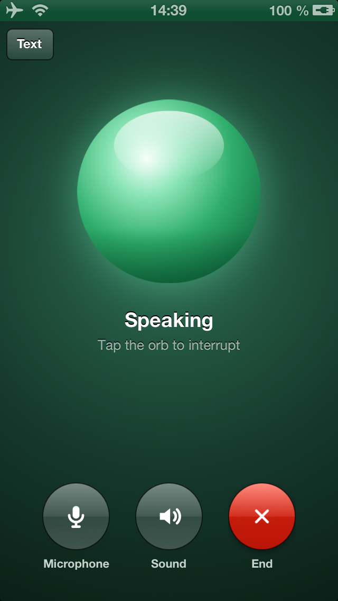

<p align="center">
  
</p>

<h1 align="center">ChatGPT X</h1>

<p align="center">
  A native ChatGPT client for iPhones running <b>iOS 6</b>.<br>
  Your ChatGPT account and your chat history on a 2012 iPhone, in the iOS 6 look.
</p>

<p align="center">
  <a href="https://github.com/ozio/chatgpt-x/releases/latest"><b>⬇︎ Download the .ipa</b></a>
  &nbsp;·&nbsp; version 1.0
</p>

> [!IMPORTANT]
> **ChatGPT X is an unofficial fan project.** It is not affiliated with, endorsed by
> or sponsored by OpenAI. I hold no rights to ChatGPT, OpenAI or their trademarks;
> "ChatGPT", "OpenAI" and the OpenAI logo belong to OpenAI.
>
> The project is a hobby experiment, not a product: no support, no guarantees, and
> not meant for real-world use. It is completely free and always will be. The repository has no
> assets or strings taken from the official app and no decompiled code. The code
> and texts were written from scratch. The icon is a new drawing in the iOS 6 style
> of the OpenAI logo.
>
> If OpenAI finds that this project breaks its rules, the repository will be taken
> down at their first request.

<!-- Screenshots: English locale, iPhone 5, iOS 6.1.4 -->
<p align="center">
  
  
  
  
</p>

## Thank you, OpenAI

Special thanks to OpenAI for ChatGPT, a wonderful product. This project exists only
because it is such a pleasure to use, and we wanted to use it on the phones we still
love.

## What it can do

ChatGPT X is the full ChatGPT, not a chat box on top of an API key or an SDK. You
sign in with your normal ChatGPT account, and the app talks to the same service as
chatgpt.com: your plan, models, history, projects, memory, voice and Codex. There
is no API key, no OpenAI developer account and no Mac or proxy in between.

- **Chats:** new chats, history and search, streaming answers with stop and
  continue, editing and regenerating, branches, temporary and locked chats, pins,
  archive, sharing links, Markdown, code blocks, tables and citations.
- **Models:** model and mode picker, reasoning effort, deep research, study mode,
  web search, translation.
- **Voice:** realtime voice conversations with interruptions, voice and language
  choice, transcripts, dictation and read aloud.
- **Files and images:** camera and photo attachments, image generation, an image
  library, a full-screen viewer, saving and sharing.
- **Projects, Library and GPTs:** projects with instructions, the Library with
  folders, trash and search, the GPT catalog.
- **Tasks:** scheduled tasks you can create, edit, pause and run now.
- **Memory and personalization:** saved memories, custom instructions, appearance
  (light and dark), English or Russian interface, and a side menu you can
  customise.
- **Account:** email, Google and authenticator sign-in, session restore, devices
  and sessions, privacy controls and locked chat PIN.
- **Codex:** connect a computer over SSH or pairing, or use a cloud environment.
  Run and review tasks, approve actions, read diffs and browse files.

The [feature map](docs/feature-map.md) lists all 527 features of the current
official iOS app and shows which ones ChatGPT X covers.

## Compatibility

| | |
|---|---|
| **Tested on** | iPhone 5 (GSM, `iPhone5,2`), iOS 6.1.4 (10B350), English and Russian interface |
| **Should work** | Other armv7 iPhones and iPod touch on iOS 6.0–6.1.6. Not tested. |

## Installing

ChatGPT X is not signed by Apple, so a stock iPhone can't install it. Prepare the
phone first:

1. **Jailbreak the iPhone.** On an iPhone 5 with iOS 6.1.3 or 6.1.4, the usual
   untethered tool is [p0sixspwn](https://theapplewiki.com/wiki/P0sixspwn).
2. **Install AppSync Unified** from Cydia. Add Karen's repo
   `https://cydia.akemi.ai/`. AppSync lets iOS install IPA files that are not
   signed by Apple.

Then get the app in one of two ways.

**A. Download the release.** Get `ChatGPTX-1.0.ipa` from
[Releases](https://github.com/ozio/chatgpt-x/releases/latest) and install it with
`appinst` (it comes with AppSync Unified), Filza or any IPA installer, for example
`appinst ChatGPTX-1.0.ipa` over SSH. The IPA bundles the third-party components
listed in [THIRD_PARTY.md](THIRD_PARTY.md), including Web Port and the Sentinel
modules that chatgpt.com serves to every browser.

**B. Build it yourself.** Follow [docs/development.md](docs/development.md) and
[docs/building.md](docs/building.md), then run `make phone` to build and install
over USB.

Open **ChatGPT X** and tap **Log in**. The ChatGPT sign-in page opens inside the app,
and every method works there: email and password, Google, Apple or a phone number.
You enter your password and codes only on that page. The app keeps the session in
the iPhone's keychain.

## Reviving the old web view

iOS 6 Safari and its web view can no longer open today's web. ChatGPT X embeds
[Web Port](https://lululab.net/) by **lululab**, a port of a modern WebKit engine
to iOS 6, and runs the sign-in page and the web parts of the service on it. The
app also carries its own TLS stack and root certificates, so it doesn't depend on
iOS 6's outdated ones. Many thanks to lululab for Web Port.

## Building

The app is Objective-C (manual retain/release) built with [Theos](https://theos.dev)
against the iOS 6.1 SDK for armv7. The build needs several pinned third-party
libraries and one module from chatgpt.com that is not stored in this repository.
[docs/building.md](docs/building.md) has the full list and the steps.

## What's where

```
ios/
  chat/             app controllers: root, conversation, session, Codex screens
  api/              request layer: OR6APICore + feature modules (priority*/revisit*/codex)
  auth/             sign-in page, web session, keychain
  ui/               the UI kit (RC*), feature screens (priority*), kit gallery app
  voice/            realtime voice runtime (WebRTC, Opus)
  webport/          loader for the embedded modern web engine
  localization/     Client.strings (app) and Kit.strings (kit), English and Russian
  standalone/chat-app/   the Theos project that builds ChatGPTX.app
  phone-tools/      small on-device helper used by the install tooling
support/            operation contracts (JSON schemas) shipped in the app; build helpers
scripts/            build-chat.py (build an IPA), phone.py (USB install, screenshots, taps)
tools/              npm build tools; theos/ installs the pinned iOS 6 toolchain
design/             app icon sources; uxui/ is the HTML prototype of every screen
docs/               guides, UI kit catalogue and the feature map
tests/              fixtures compiled only into acceptance builds
```

| Document | For |
|---|---|
| [docs/development.md](docs/development.md) | Toolchain, everyday build-and-deploy loop, kit gallery, troubleshooting |
| [docs/building.md](docs/building.md) | Every build input and how to get it |
| [docs/device.md](docs/device.md) | USB install tooling and its safety rules |
| [docs/feature-map.md](docs/feature-map.md) | All official app features and their status here |
| [docs/ui-kit.md](docs/ui-kit.md), [docs/ui-kit-brief.md](docs/ui-kit-brief.md) | UI kit catalogue and rules |
| [AGENTS.md](AGENTS.md) | Instructions for AI agents |

## Contributing

Contributions are welcome. Read [CONTRIBUTING.md](CONTRIBUTING.md) first. It covers
the project layout, the UI kit rules, commit naming and how to compare behaviour
with the official app.

## License

The code in this repository is released under the [MIT License](LICENSE).
Third-party components keep their own licenses, listed in
[THIRD_PARTY.md](THIRD_PARTY.md).
